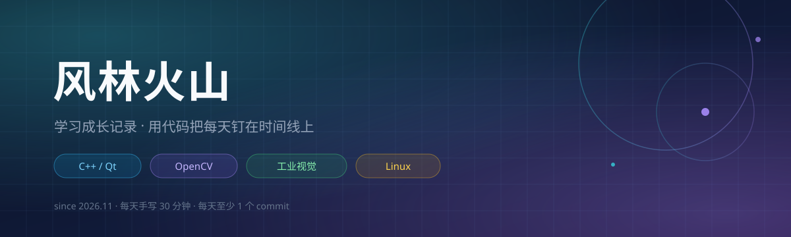

# 🧭 学习成长记录

<div align="center">
  
</div>

<div align="center">


**大二上 · 2026.11 起 · C++ / Qt / OpenCV 工业视觉方向**

</div>

---

## 🌱 这是什么

这是我的**个人学习成长仓库**，用来记录每天写的代码、踩过的坑和想明白的事。

它不追求"好看的作品集"，而是**一条看得见的成长轨迹**——
一年后回看，每一行代码、每一个 commit，都是"我没有颓废"的证据。

> **每天手写 30 分钟 · 每天至少 1 个 commit · 每周日断网裸写**

## 🎯 路线图

| 阶段 | 时间 | 目标 | 状态 |
| :-- | :-- | :-- | :--: |
| 地基 | 2026.11 – 2026.12 | C++ 语法 / Qt 控件与信号槽 / OpenCV 入门 | 🟢 进行中 |
| 核心 | 2027.01 – 2027.06 | 多线程 / MySQL / Linux / 网络 / 工业视觉补丁 | ⬜ |
| 项目 | 2027.07 – 2027.08 | 工业检测系统 v1.0 + 暑期实习 | ⬜ |
| 冲刺 | 2027.09 – 2028.12 | 实习积累 / 秋招 | ⬜ |

## 📂 目录结构

```text
.
├── cpp/          # C++ 练习，按「年-月/日期-主题」归档
├── qt/           # Qt 小项目（计算器、登录界面、检测界面…）
├── projects/     # 综合项目（视觉工具、工业检测系统）
├── notes/        # 每日笔记、八股卡片（notes/bagu/）
├── docs/         # GitHub Pages 个人主页
├── profile/      # GitHub 个人主页 README 模板
└── assets/       # 横幅与图片
```

## 📈 数据

<div align="center">

<a href="https://github.com/WMWWZS">
  
</a>
<a href="https://github.com/WMWWZS">
  
</a>


</div>

<!-- 如果你的 GitHub 用户名不是 WMWWZS，把上面三处 WMWWZS 全部替换成你的用户名 -->

## 🧭 这个仓库怎么用

1. **每天一个 commit**，message 写清做了什么：`feat(qt): 登录界面布局`
2. **每天一篇笔记**：`notes/YYYY-MM-DD.md`，写学到什么、卡在哪、怎么解决的
3. **每周日复盘**：更新上面的路线图状态，把这周最值钱的 1 个收获写进笔记
4. **代码放进对应目录**：不要堆在根目录；每个小项目一个文件夹，配一个 README
5. **视频、安装包、构建产物不进仓库**（见 `.gitignore`）

## 🔗 相关

- 📅 [学习计划（4 周逐日）](notes/PLAN.md)
- 🃏 [八股卡片](notes/bagu/)
- 🏠 [我的 GitHub 主页](https://github.com/WMWWZS)
- 🌐 [线上个人主页](https://wmwwzs.github.io/learning-journey/) · 粒子星河动态版（开启 GitHub Pages 后生效）

---

<div align="center">

**Stay hungry. Stay foolish.**

`2026.11` · 从今天开始，每天都算数

</div>
