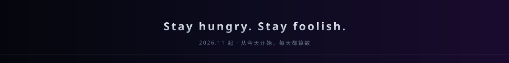

<div align="center">
  
</div>

<div align="center">

[](https://wmwwzs.github.io/learning-journey/#skills)
[](https://wmwwzs.github.io/learning-journey/#skills)
[](https://wmwwzs.github.io/learning-journey/#skills)
[](docs/STRUCTURE.md)
[](https://wmwwzs.github.io/learning-journey/#skills)
[](https://github.com/WMWWZS/learning-journey/commits/main)

<!-- PROGRESS:BEGIN -->
**当前进度**：C++ 33% · Qt 40% · OpenCV 25% · Linux 0% · [看详情 →](https://wmwwzs.github.io/learning-journey/#skills)
<!-- PROGRESS:END -->

[](https://wmwwzs.github.io/learning-journey/)
[](notes/PLAN.md)
[](notes/bagu/)

</div>



## `01` 这是什么

我的**个人学习成长仓库**：每天写的代码、踩过的坑、想明白的事，都在这里。

不追求好看的作品集，只想要一条**看得见的成长轨迹**。一年后回看，每一行代码、每一个 commit，都是"我没有颓废"的证据。

## `02` 现在在做什么

| 模块 | 在学什么 | 产出 |
| :-- | :-- | :-- |
| **C++** | 类与对象、拷贝语义、继承多态、模板 STL | 每日练习 → [`cpp/`](cpp/) |
| **Qt** | 控件、布局、信号槽、事件、QSS | 计算器、登录界面 → [`qt/`](qt/) |
| **OpenCV** | 图像读写、阈值、形态学、参数联动 | 视觉工具 v0.5 → [`projects/`](projects/) |
| **工程** | Git、CMake、Linux 基础 | 每天 1 个 commit |

## `03` 路线图



## `04` 贡献记录

<picture>
  <source media="(prefers-color-scheme: dark)" srcset="https://wmwwzs.github.io/learning-journey/snake-dark.svg" />
  <source media="(prefers-color-scheme: light)" srcset="https://wmwwzs.github.io/learning-journey/snake-light.svg" />
  
</picture>

<sub>由 GitHub Actions 每天自动生成，格子越亮，那天喷发得越猛。</sub>

> 首页的提交记录与热力图由 Actions 每天同步到 `docs/data/commits.json`，国内网络也能正常显示。

## `05` 参考

<details>
<summary><b>仓库结构</b></summary>

```text
.
├── cpp/          # C++ 练习，按「年-月/日期-主题」归档
├── qt/           # Qt 小项目
├── projects/     # 综合项目（视觉工具、工业检测系统）
├── notes/        # 每日笔记、八股卡片
├── docs/         # GitHub Pages 个人主页
├── profile/      # GitHub 个人主页 README 模板
├── archive/      # 2026 上半年旧练习归档（只含源码）
└── assets/       # 横幅、数据面板、路线图、页脚
```

**每个文件干嘛的、要不要手改 → [docs/STRUCTURE.md](docs/STRUCTURE.md)**

</details>

<details>
<summary><b>每日记录规则</b></summary>

1. **每天一个 commit**，信息格式：`类型(模块): 内容`（如 `feat(qt): 登录界面布局`）
2. **每天一篇笔记**：`notes/YYYY-MM-DD.md`，写学到什么、卡在哪、怎么解决
3. **每周日复盘**：更新 `docs/data/progress.json`（技能温度 / 路线进度 / 项目功能都在这里，Actions 会自动生成页面数据和 README 用的 `assets/dashboard.svg`），把这周最值钱的 1 个收获写进笔记
4. **代码放进对应目录**，每个小项目一个文件夹 + 一个 README
5. **视频、安装包、构建产物不进仓库**（见 `.gitignore`）

</details>


